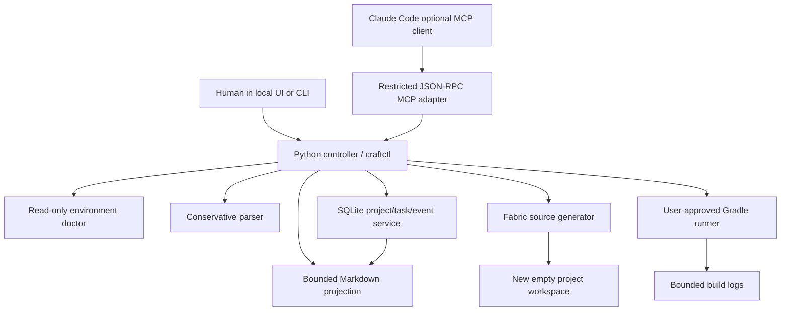
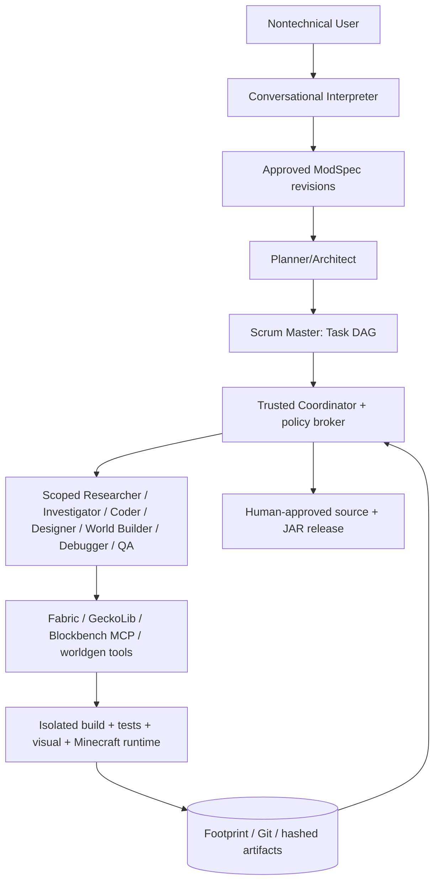

# Architecture: implemented foundation versus target

## Current implementation (v0.1)



### Implemented primitive boundaries

- **Agent:** Claude Code file-based prompts in `.claude/agents`; optional adapter only. No built-in LLM runtime yet.
- **Skill:** procedural Markdown in `.claude/skills/` with scope, references, safeguards and return contract.
- **Tool:** typed `craftctl` CLI/MCP operations for diagnostics, spec, planning, generation, validation, state and Gradle build.
- **Hook / service:** SQLite state transitions are authoritative; developer hooks are a future supplemental mechanism.

**What is explicitly not implemented:** arbitrary spec planning with an AI, concurrent Git worktree integration, rich schema migrations, E2E gameplay automation, live JVM log streams, managed Gradle/JDK installation, OS sandboxes, Blockbench MCP bridge, approval transactions for arbitrary external plugins, provider-neutral AI inference. These are sequenced in the roadmap.

## Data flow and source-of-truth

1. User describes idea; the raw idea is retained. Current parser recognizes `items:` and `blocks:` only.
2. Unsupported or consequential advanced terms create blocking questions.
3. User approves the typed specification. The controller records a SQLite event and completes a task with evidence.
4. Scrum-like task graph tracks interpreter, scaffold, feature generation, build and gameplay check dependencies.
5. Deterministic generator writes a **new** Fabric folder. Source code, JSON metadata, 16x16 PNG placeholders and file SHA-256 hashes are produced.
6. `validate` checks manifest integrity and JSON parseability; it **does not compile or launch** the mod.
7. Gradle builds require an approval record that matches the exact project, action and version context; same token cannot be replayed.
8. A successful build advances status to `BUILD_PASSED_GAME_UNTESTED`; game testing remains a separate task.

## Trust boundary

```mermaid
flowchart LR
  U[User] --> UI[Local authenticated UI/CLI]
  UI -->|Approves concrete request| Core[Local controller]
  LLM[Potentially untrusted LLM/plugin] -->|Restricted tool call| MCP[MCP facade]
  MCP --> Core
  Core --> DB[(SQLite Footprint)]
  Core --> Files[Managed new workspaces]
  Core -->|Only user-approved| Gradle[Unsandboxed Gradle process (pre-alpha)]
```

- This local tool controller **does not** sandbox arbitrary shell-capable agents or untrusted Gradle scripts. Role definitions and hooks must not be sold as security enforcement.
- MCP doesn't expose permission granting or direct arbitrary commands. A Claude agent still may have other terminal privileges granted by the user's Claude Code settings; secure deployment requires OS isolation and permission hardening.
- Workspaces are only created within `CRAFTCTL_HOME/projects`. Symlink escape attempts are rejected by the generated file writer. There is not yet an atomic workspace staging/rename transaction; recovery is required after partial disk failure.

## Fabric generator

The `fabric-1.21.1-candidate` profile mirrors the official FabricMC example mod (branch `1.21.1`, commit `684b581`): Minecraft 1.21.1, **Mojang official mappings**, Loom 1.18 (`net.fabricmc.fabric-loom-remap`), Loader 0.19.5, Fabric API 0.116.17+1.21.1, Gradle 9.7.1; JDK 25 runs Gradle, sources compile with `--release 21`. Generator output has been build-verified and tested in-game (2026-10-20; `examples/crystal_example/EVIDENCE.md`). Evidence levels `BUILD_PASS` (controller, from an approved build) and `CLIENT_BOOT_PASS` / `SERVER_BOOT_PASS` / `CONTENT_VERIFIED` (user-only, `craftctl evidence`) are stored per project with the workspace manifest hash and JAR SHA-256; all three game levels promote a project to `GAME_VERIFIED`. A verified profile is only promoted after Gradle client and dedicated server checks.

## Target architecture (from v2 master plan)



Missing infrastructure is deliberately staged in `docs/ROADMAP.md`; do not confuse this diagram with shipping features.

## State DB schema versioning (STA-001)

`state.MIGRATIONS` is an append-only list of `(version, title, sql)`. `Store()` reads `PRAGMA user_version`; a fresh DB gets every step, an older DB gets only the missing steps (each in its own transaction, `user_version` bumped per step) after a `state.sqlite.bak-v<N>` copy made with the SQLite backup API, and a DB whose version is newer than the code refuses to open. Never edit a shipped step; add a new one. `craftctl doctor` reports `schema.version` vs `schema.current`.

## Atomic workspace install (SEC-001)

`fabric.generate` never writes to `projects/<id>/` directly. Files are written and hash-validated in `projects/.staging/<name-slug>-<id>-<UTC stamp>-<4 hex>/` (slug omitted when it equals the id) and then moved into place with a single `os.replace`. The final path therefore either does not exist or holds a complete, validated workspace; a crash leaves only a staging directory, which `craftctl doctor` lists and the next `generate` sweeps once it is older than one hour. A non-empty or symlinked final path is refused before any staging work starts.

## Process broker (SEC-002)

`broker.run_logged` is the only place the controller spawns an external process. The child gets a minimal allow-listed environment (never `os.environ` wholesale), runs in its own session/process group, writes stdout+stderr to the project log file, and on timeout (`CRAFTCTL_BUILD_TIMEOUT`, default 1800 s) the whole process tree is killed (`killpg` / `taskkill /T`). The Footprint records pid, duration, exit code and whether it was killed.

## Redaction (SEC-003)

`redact.redact` scrubs the user home (`~`), the craftctl home (`<craftctl-home>`), the projects root (`<projects>`) and common secret shapes (GitHub tokens, bearer tokens, `key=value` credentials, AWS keys, private keys) from everything that leaves the local trust boundary: every event payload (single choke point in `Store.event`), approval descriptions, `craftctl logs` / `diagnose` excerpts, and agent handoff packets. The on-disk build log stays verbatim for the user.

## Controller-driven dispatch (R2)

`dispatch.dispatch(store, project, task_id?, provider?)` is the only way an agent is started from application state: pick a READY task → lease it as `agent:<role>` → build a `TaskEnvelope` (bounded, redacted handoff packet + workspace) → `provider.run` → validate the handoff → map it onto the task → record the run. Workers never set task state; their handoff `status` is a claim the controller checks.

- `provider.AgentProvider` is the interface (`run(envelope, log) -> RunResult`, synchronous, one worker). `ClaudeCodeProvider` runs the user's installed Claude Code headless (`claude -p … --agent <role> --agents <json> --settings <json> --mcp-config <json> --strict-mcp-config --permission-mode acceptEdits --max-turns N --output-format json`) through the process broker, with the workspace as cwd, the packaged agents/skills/guard/deny rules from `src/mod_orchestra/resources/claude/` (kept byte-identical to `.claude/`, test-enforced) and the user's own login — no API key in v1. `FakeProvider` replays a scripted reply for tests and `craftctl dispatch --provider fake`.
- Handoff contract: a fenced ```` ```handoff ```` JSON block with `task, status (DONE|WAITING_USER|BLOCKED|FAILED), scope, changed_files, checks_run[{command, exit_code}], evidence{level, pointer}, risks, unknowns, needs_user, next_agent`. Workers may claim only `STATIC | BUILD_PASS | BUILD_FAILED | NONE`; `BUILD_PASS` needs a gradle command with exit 0 in `checks_run`; `DONE` may not carry `needs_user`. Anything else fails the run and the task (`last_error`), and `craftctl requeue` returns it to READY.
- Manifest revisions: when a run ends DONE or WAITING_USER with `changed_files`, the controller re-hashes the union of files reported by every run of that task and appends a revision `{run, actor, at, files}` to `generation-manifest.json` (`CHANGES_ACCEPTED` event). `validate` overlays revisions on the generation hashes, so agent edits are attributable and buildable through `request-build`, while any file that differs but was not reported stays `CHANGED` (unreported = tampered).
- Task states: `BACKLOG, READY, LEASED, RUNNING, DONE, WAITING_USER, BLOCKED, FAILED, CANCELLED`. `runs` table (schema v3) records provider, timing, exit code, log path, session id, cost, turns and the accepted handoff.
- `dispatch.orchestrate` is the coordinator loop: dispatch READY tasks one after another until a WAITING_USER/BLOCKED/FAILED outcome (the user is needed) or a budget is hit (`--max-runs`, `--max-cost-usd`, `--max-seconds`). It first reconciles runs left RUNNING by a controller that died (restart safety); task leases expire on their own.
- Project deletion: CLI (`craftctl delete`) and the UI (type-to-confirm, refused while a job runs); never MCP.
- USER-ONLY around dispatch: `craftctl dispatch`, `orchestrate`, `requeue`, `add-task`, `accept-changes` (denied to agents by settings and guard). The UI can call them: it is the authenticated local user.

## Repair loop and server smoke (R5)

- `repair.open_repair_task` creates `<project>:REPAIR:<n>` for the **debugger** whenever a build fails: from `craftctl build` (exit ≠ 0), from a worker whose handoff reports `evidence.level: BUILD_FAILED`, or from a failed server smoke. The repair packet appends the `diagnose` classification, the build log tail and, if present, the server-smoke lines mentioning the mod. Repairs are dispatched before any other READY task. After `MAX_ATTEMPTS` (3) failed repairs in one episode the loop emits `REPAIR_EXHAUSTED`, blocks, and `orchestrate` stops with the reason. A repair that reaches `DONE` closes the episode; the user's trusted `craftctl build` confirms it.
- `craftctl break <project> --fault {missing-import|wrong-mapping|bad-loot-json}` (USER-ONLY fixture) injects one known failure as a user-attributed manifest revision: two compile failures and one server-side datapack failure (valid JSON, unknown item id) that only the dedicated server reports.
- `craftctl request-smoke` / `server-smoke` run `gradlew runServer` in the project's isolated `run/` under a one-use approval whose text states it accepts the Minecraft EULA in `run/eula.txt`. `broker.run_watch` tails the log until `Done (…)!`, then sends `stop` and kills the tree if it does not exit. The controller records `SERVER_BOOT_PASS` itself when the mod is in the loaded list and no ERROR/FATAL/Exception line mentions the mod; otherwise it opens a repair task. Client boot and in-game content remain user-only evidence.

## Static content (v1 criterion 2)

Spec schema 2 adds `recipes` (shaped / shapeless / smelting / blasting / smoking / campfire_cooking, with counts, namespaced vanilla ids and `#tags`), `drops` (ore-style loot: item with count range, Fortune `ore_drops`, Silk Touch returns the block) and `tab` / `tab_icon` (own `CreativeModeTab` via `FabricItemGroup`). The generator renders vanilla 1.21.1 JSON (`recipe/`, `advancement/recipes/` unlock advancements, `loot_table/blocks/`) and the Java tab registration. Before generation the user fills these with `craftctl add-recipe / add-drop / set-tab` (every edit returns the spec to DRAFT); in R3 the interpreter agent fills the same fields from the user's words. The shared `recipes` skill carries the formats and the standard tool/armor patterns for agents writing JSON after generation.

## Conversational interpreter (R3, v1 criterion 1)

`craftctl new` accepts free text; if the deterministic grammar extracts nothing, the project is created with one open question and the `<project>:SPEC` task (role interpreter) is the only task dispatchable before approval. The interpreter worker receives the idea plus `interpreter.SPEC_INSTRUCTIONS` (the exact schema-2 proposal shape and the validation rules) and returns `spec` + at most three `questions` in its handoff with status WAITING_USER. The controller validates the proposal with the same rules as `craftctl add-recipe/add-drop/set-tab` (`interpreter.spec_from_proposal`; identity fields cannot be changed by the worker), stores it as the DRAFT spec (`SPEC_PROPOSED`), and parks the task: `craftctl answer <id> "..."` appends the answer to the idea and reopens the task; `craftctl approve-spec` closes it. Rejected proposals fail the run and leave the stored spec untouched. `craftctl interpret-suite` runs `tests/v1/prompts/*.json` through the real interpreter and scores them into `tests/v1/results/`.

## Mobs (R6 scaffold, v1 criterion 6)

Spec `mobs` (`craftctl add-mob`, grammar `mobs: a, b` / `hostile mobs: c`, or the interpreter) → `geckolib.py` emits, per mob: `entity/<Name>Entity.java` (`PathfinderMob` or `Monster` implementing `GeoEntity`, attributes, vanilla goals, one `AnimationController` switching idle/walk on `isMoving()`, and for hostile/neutral mobs a triggerable one-shot `attack` fired from `doHurtTarget` via `triggerAnim`; a biped, or any mob with `held_item` set, also equips its best weapon/tool (`geckolib.held_item_for`: explicit `held_item`, else sword > axe > pickaxe > shovel > hoe among its drops) in `finalizeSpawn` with a 0 drop chance, and its renderer draws it on the model's `held_item` bone through GeckoLib's `BlockAndItemGeoLayer`; install fails when the model lacks that bone. The held weapon adds its own attack-damage modifier to the mob, as vanilla mobs with swords do), `client/<Name>Renderer.java` (`GeoEntityRenderer` + `DefaultedEntityGeoModel`), `client/ModClient.java` (`EntityRendererRegistry`), `EntityType` + `SpawnEggItem` registration and `FabricDefaultAttributeRegistry` in `ModMain`, entity loot table, lang, and placeholder assets in the `DefaultedEntityGeoModel` layout (`geo/entity/<id>.geo.json`, `animations/entity/<id>.animation.json` idle+walk and `textures/entity/<id>.png` taken from the **rig library**: `rigs.py` holds six original base rigs as data — `body_plan` ∈ quadruped, biped, bird, fish, serpent, insect, set by `add-mob --body-plan` or the UI — with a box-UV shelf packer; `scripts/regen_rigs.py` builds `resources/blockbench/rigs/<plan>.{bbmodel,geo.json,animation.json,recipe.json}` through `scripts/build_rig.mjs`, i.e. the vendored blockbench-mcp-safe code itself, with deterministic UUIDs; `tests/test_rigs.py` rebuilds them and compares). `build.gradle` gains the GeckoLib Cloudsmith repository and `modImplementation software.bernie.geckolib:geckolib-fabric-1.21.1:4.7.3` only when the spec has mobs; `fabric.mod.json` adds the `client` entrypoint and `geckolib >= 4.7`. Each egg also gets `models/item/<id>_spawn_egg.json` (`minecraft:item/template_spawn_egg`, tinted from the two `egg_colors`, which `default_egg_colors()` derives from the identifier so two eggs never look alike: dark base for hostile, bright for passive) and the entity loot table uses the 1.21 `enchanted_count_increase` function. Vanilla logs `No data fixer registered for <id>` at ERROR for every modded `EntityType` without a DataFixer schema entry; it is harmless and `smoke.BENIGN` keeps it from opening a repair. Verified in Round 4 (scratch workspace from the same spec): `gradlew build` passes against GeckoLib 4.7.3, the dedicated server boots with the mod and GeckoLib loaded. The designer worker (next slice) replaces the placeholders with a real `.bbmodel` exported to geo + animation.

## Designer worker and Blockbench (R6 slice 2)

`plan` adds `<project>:MODEL:<mob>` (role designer) for every mob, between SCAFFOLD and BUILD. The designer runs with a second MCP server, `blockbench`: the vendored zero-dependency `tools/blockbench-mcp-safe` (MIT; packaged under `resources/blockbench-mcp-safe/`, test-enforced identical), started by the controller as `node server.mjs --root <workspace>/models --allow-write`. No npm, no network. Before dispatch `models.rig_block` places the mob's base rig as `models/<mob>.bbmodel` (identifier, mod id and clip names renamed; never over an existing source) and describes its bones and adaptation notes in the packet. The worker follows the `blockbench` skill (edit the staged rig → texture → retune idle/walk → validate → render → export) and reports the four deliverables. On DONE the controller validates them (`models.validate_model_files`: geo identifier, idle/walk present, animated bones exist in the geo, PNG matches the declared resolution) and installs geo/animation/PNG over the placeholders as a manifest revision (`MODEL_INSTALLED`); the `.bbmodel` stays in `models/` as the editable source. CI runs `scripts/blockbench_oracle.py` on Linux: it builds a critter with the safe server and cross-checks it with jasonjgardner/blockbench-mcp-plugin's validators and exporter (never on the owner's machine).

## UI (v1 criterion 7)

`craftctl ui` serves a single-page, dependency-free dark UI (`static/`) over the local token-protected API. Everything the user sees first is computed server-side so CLI and UI agree:
- `guidance.py`: the project's **stage** (idea → spec → source → model → build → server → client → verified), a headline, what the last worker did, and **next steps** with `who` (user / agent / controller) and a runnable `action` (dispatch, answer, approve, generate, request-build, decide, build, request-smoke, server-smoke, run-client, evidence, requeue). Long operations run as background jobs (`start_job`): the page polls `/api/project/<id>` and shows the job, elapsed time and result.
- `feedback.py`: the **model gallery** (per mob: placeholder vs designer model, `.bbmodel`/geo/animation presence, designer previews and texture served through `/api/project/<id>/file?path=…&token=…` — PNG/JSON under `models/` or `assets/<mod>/` only) and the **feedback loop**: the user's note is stored (`MODEL_FEEDBACK`), the MODEL task is reopened, and the next designer run receives every note in its packet with the instruction to edit the existing `.bbmodel` rather than start over.
- Interpreter questions are answerable inline; approvals are granted from the Now panel; evidence is recorded from Verification; the Activity tab shows every run with its handoff, needs_user commands and worker log.
- Generation tolerates a controller-owned `<workspace>/.mod-orchestra` created by a pre-generation interpreter run; `approve-spec` re-plans while no source exists so the task graph matches the approved spec (`TASK_GRAPH_REPLANNED`).

## Adding content after generation (mobs, items, blocks)

Generated projects are never regenerated in place, but content can grow. `content.add_feature` (UI Features → Items) writes a new item's or block's own files (model/blockstate/texture/loot/lang) and creates `ADD_ITEM:<id>` / `ADD_BLOCK:<id>` for the coder with the exact `ModMain` registration lines; `content.rename_feature` edits the lang; removal after generation is not offered. `craftctl add-mob` (and the UI's "Add a mob") on a generated project calls `models.add_mob_after_generation`: the controller writes the mob's own new files deterministically (entity class, renderer, placeholder geo/animation/texture, loot table, spawn-egg item model, merged lang keys) as a user revision, updates the spec, and creates `<project>:ADD_MOB:<mob>` for the coder with the exact registration snippets for `ModMain`/`ModClient` (plus the GeckoLib dependency/client entrypoint when it is the mod's first mob) stored in `task_instructions` (schema v4), followed by `MODEL:<mob>` for the designer. A DONE coder or designer task reopens BUILD and GAME so the trusted build runs again on the new source.

## Editing a model without redesigning it (size)

`Mob.scale` (default 1.0, range 0.0625–16, the clamp of vanilla's `Attributes.SCALE`) resizes a mob without an agent: `craftctl edit-model <project> --mob X --scale 1.5`, or **Resize** on the mob card (UI route `mob-scale`). The generator writes it as one more call in the entity's `createAttributes()` chain, right after `MOVEMENT_SPEED` and only when it is not 1.0. That single attribute does everything: vanilla scales the hitbox, eye height and step height from `LivingEntity.getScale()`, and GeckoLib's `GeoEntityRenderer` (checked in its 1.21.1 source) draws the model with the same value, so the renderer, `ModMain`, the geometry and the texture stay untouched. Scaling the geometry instead would break box UV, since a cube's size decides its texture area. Before generation the change is a spec edit and returns the spec to draft. After generation `models.set_mob_scale` updates the spec and patches the entity class as a user revision (`models.patch_scale` changes, inserts or, for 1.0, removes the call; patching gives the same bytes as generating with that scale, CRLF kept), and resets verification and reopens BUILD/GAME. The class is patched only when its hash is exactly what the manifest records (the generator's file or an accepted revision) and it has the generated chain. Otherwise nothing is written: a coder task `<project>:SCALE:<mob>` gets the one-line change as its brief, so a coder's work on the class is never overwritten and an unreported edit is never accepted along with the patch. A second resize before that task starts rewrites its brief. Mobs already saved in a world keep their stored attribute; new spawns get the new size.

## Modifying a model, and using your own

**Modify** (`modeledit.request_model_edit`; mob card → *Modify this model*; `craftctl modify-model <project> --mob X --request "…" [--may-change bone …]`) changes a finished model without redesigning it. The controller snapshots the mob's exports (`models/<mob>.geo.json`, `.animation.json`, `.png`, `.bbmodel`) into `.mod-orchestra/model-edits/<mob>/<edit>/`, records `MODEL_EDIT_REQUESTED` and requeues the MODEL task. While a modification is pending (`pending_edit`: the newest request, unless an install, a redesign request, an import or a cancel came after it), `build_envelope` gives the designer `EDIT_INSTRUCTIONS` with the user's words verbatim instead of the new-design brief: no takes, no rig, no restyle, and no design notes are recorded. On DONE, `check_edit` compares the new exports with the snapshot **before** `install_model`, and the install is refused (task FAILED, game files untouched, the modification stays open for a retry) if any existing bone the user did not open (`may_change`, nothing by default: it only adds) was removed or changed (parent, pivot, rotation, cubes, UV), if its keyframes in an existing clip changed, if a clip was removed or changed length or loop, if the layout shrank or changed its pixels per UV unit, if a pixel inside an existing protected cube's box-UV strip changed, or if a new cube's UV overlaps a protected strip. The comparison works on the exports because they are what reaches the game and carry no tool-specific ids. The designer gets two MCP tools for this (both copies of `designer.md` allow them): `orchestra_check_model_edit` runs the same check before it finishes, and `orchestra_grow_texture` doubles the texture height in the `.bbmodel` and the PNG, keeping every UV and pixel, when there is no free room for new parts. `orchestra_paint_skin` takes `only_bones` to paint only the new parts over the current PNG. An accepted modification records `MODEL_EDIT_APPLIED` with the added and changed bones. Every install now keeps the whole model (`.bbmodel`, geo, animation and texture) in its `.mod-orchestra/previews/<run>/` version, not only the pictures.

**Use my model** (`modeledit.import_model`; *Use your own model*; `craftctl import-model <project> --mob X --bbmodel f.bbmodel [--png f.png]`) installs a box-UV `.bbmodel` the user made or downloaded, with no agent. `resources/blockbench/export_bbmodel.mjs` runs the vendored server's `exportGeometry` and `exportAnimations` (Node only, no network) after normalizing what outside files differ in: Blockbench 4.x bones inline in the outliner are lifted into `groups`, the identifiers become this mob's, clips are renamed `animation.<mob>.<last segment>`, and numeric keyframe strings become numbers. Molang expressions and per-face UV are refused with the reason. The texture is the one the user gives, otherwise the embedded one, and it is embedded in the installed `.bbmodel`. Everything is validated with `validate_model_files` in a probe folder before anything is copied, then installed like a designer delivery as a user revision (`MODEL_IMPORTED`), so Modify, Redesign and Open in Blockbench work on it. *Install my Blockbench edits* (`--from-blockbench`, `reinstall_from_blockbench`) runs the same path on `models/<mob>.bbmodel`, using the PNG beside it when the texture is not embedded.

## Mob drops and the item catalog

`Mob.drops` entries are `MobDrop(item, count_min, count_max, chance)` (plain ids still accepted); the entity loot table gets one pool per drop with `set_count`, Looting via `enchanted_count_increase`, and `random_chance` when chance < 1. Behaviours: passive, neutral (`HurtByTargetGoal` + melee, like a wolf), hostile. The UI's drop picker lists the mod's items/blocks (from its texture folders) and vanilla ones read from the Minecraft client jar already present in the local Loom cache (`catalog.py`; Mojang assets are never copied into the repo); `set_mob_drops` edits the spec and, once generated, rewrites the loot table as a user revision and reopens BUILD.

## Tool/armor sets and foods (carril 1)

`Material` = a tier plus the pieces to generate: `tools` ⊆ {sword, pickaxe, axe, shovel, hoe}, `armor` ⊆ {helmet, chestplate, leggings, boots}, with durability, mining speed, attack bonus, mining level (mapped to `BlockTags.INCORRECT_FOR_*_TOOL`), enchantability, per-piece defense, armor durability multiplier, toughness, knockback resistance and an ingredient (local, vanilla or tag) used for repair and the standard vanilla crafting patterns. `gear.py` emits a `Tier` class per material, tool items with vanilla `createAttributes` numbers, an `ArmorMaterial` registered as a `Holder` with two layer textures, `ArmorItem`s, item models (handheld for tools), placeholder textures, lang, creative-tab lines and recipes. `Food` = item with `FoodProperties` (nutrition, saturation modifier, optional effects, always edible, fast). Both are added before generation via `craftctl add-material / add-food` or the UI, and after generation through `content.add_material_any / add_food_any` (files + `ADD_MATERIAL` / `ADD_FOOD` coder task with the exact registration snippets). The interpreter proposes them from free text with vanilla reference numbers.

## Autopilot permissions (per project, user-set)

`orchestrate` dispatches agent tasks and, when nothing agent-side is READY, looks at the project's stage and crosses only the gates the user pre-authorised for that project (`project_settings.autopilot`, schema v5; set from the UI's Now panel or `craftctl autopilot <id> --allow …`; never by MCP): approve a spec with no questions, generate, request+grant+run the trusted build (failures enter the repair loop), request+grant+run the server smoke. It always stops for interpreter questions, an exhausted repair loop, the budget, and before the game client, which only the user can verify. `BUILD` and `GAME` are `controller` / `user` tasks and are never dispatched to agents (the R1 plan had them as coder/qa).

## Visual theme, sprites and worn armor (carril 1, art)

`Spec.theme` is a short visual brief (era, palette with hex, motifs, mood) the interpreter proposes from the idea and the user can edit in the Spec tab; `models.theme_block` injects it into every designer task (MODEL, SPRITES, ARMOR). Textures: `textures.py` draws our own 16×16 silhouettes (tools, gem, ingot, food, block) and 64×32 armor layers as shaded cube nets with an open visor, tinted per material/feature (`color`/`accent`, or a stable hue from the identifier); `palette_from_png` lets worn armor match a painted icon; users upload PNGs from the UI (`content.set_texture`). Designer tasks: `SPRITES:<n>` paints 16×16 icons by script (validated: size, transparency, not flat) with a contact sheet; `ARMOR:<material>` paints both worn layers and **must render them worn** on the shipped player template (`resources/blockbench/player_armor.bbmodel`, box UV on the armor layout) with the vendored Blockbench MCP before finishing — the controller rejects a delivery without a render, installs the layers, and keeps the renders as previews shown on the material's helmet row. `Retint worn armor` is the no-agent fallback.

## Agent runtimes

`provider.AgentProvider` is the only contract a runtime must satisfy: `run(envelope, log) -> result` with the handoff JSON the controller validates. v1 ships `ClaudeCodeProvider` (headless `claude -p`, agents and skills inlined per run, `--mcp-config` with `minecraft-orchestra` and, for designers, `blockbench`, `stream-json` output) and `FakeProvider` for tests. The MCP servers are standard stdio MCP and the guard hook is Claude Code-specific defence in depth; USER-ONLY operations are refused by the MCP server itself, so another runtime needs only an adapter. `GeminiCliProvider` is the first one (2026-11-04): `gemini --prompt <short instruction> --output-format stream-json --approval-mode yolo --skip-trust` with the full prompt on stdin (role definition + inlined skills + packet + handoff contract, so Windows' argv limit never truncates it), the two MCP servers written to the workspace's `.gemini/settings.json` (`mcpServers` with `trust: true`, `mcp.allowed` restricted to them, previous file merged and restored after the run), the user's Google login under `~/.gemini`, and `provider.parse_gemini_stream` folding the JSONL (`init` → session id, assistant `message` events → the text that carries the handoff, `result` → status and token stats, exit 53 → turn limit). Selected for every role from the UI (*Environment → Agent runtime*, stored in the global `settings` table, schema v8), by `CRAFTCTL_PROVIDER`, or per call with `--provider`; `dispatch.provider_for(store)` applies that precedence and `provider_by_name` is the single switch. Tested against a fake `gemini` binary (`tests/test_gemini_provider.py`); no guard hook on this runtime. `AntigravityCliProvider` (`agy`, 2026-11-05) subclasses it: `--dangerously-skip-permissions`, `--print-timeout` raised to the worker timeout, MCP servers in `.agents/mcp_config.json` (command/args/env only), the prompt also written to `.agents/craftctl_task.md` because stdin handling differs, plain-text output accepted as a fallback for agy < 1.1.8. Codex/OpenCode-style CLIs would follow the same shape.

## Mod Map (v2)

`modmap.py` turns the mod into a graph of **feature cards**: derived cards computed from the spec on every read (items, blocks, mobs, foods, each material as one collapsed set, the tab) with edges for what derives from what (`crafts`, `smelts_into`, `drops`, `drops_on_death`, `made_of`, `repairs`), plus **custom cards** (schema v7 `feature_cards`) for anything the spec cannot express. `map_text` is injected into every worker packet so agents know what exists and what connects without reading the code. From a card the user can **request a change** (`CHANGE:<card>:<n>`: one coder task whose brief is that card's description, files and relations plus the request) or **request a new feature** (`FEATURE:<id>`: a planned card + a coder task with the description and acceptance criteria); on DONE the agent's handoff `card` object updates the card (files, description, produces, status) and BUILD/GAME reopen. The UI's Map tab draws the graph (own SVG, layered layout, drag/zoom, positions saved per project) with a side panel for details and actions.

## GameTests

Every generated project ships `gametest/ModGameTests.java` (registered as the `fabric-gametest` entrypoint) with one check per kind of generated content, and a Loom `gametest` run that boots Fabric's headless test server and writes `build/gametest/junit.xml`. `craftctl request-gametest` / `craftctl gametest` run it through the broker (approval-gated, like the server smoke); the controller parses the JUnit report, records `GAMETEST_PASS` or opens a repair task briefed with the failing tests and the log tail. Autopilot can be allowed to run it after a passing build. The coder's `gametest` skill asks for one `@GameTest` per acceptance criterion of custom features. The test server blocks on an open stdin pipe, so the broker gives it `/dev/null` (CI does the same); with that, the generated tests run headless in CI on every push.

## Skins (hi-res, painted by the controller)

The designer no longer paints pixels by hand. `skin.py` reads the mob's `.bbmodel` (box-UV cubes, the bone each belongs to), locates the six faces of every cube with Blockbench's
box-UV rectangles, fills each with its zone colour (`zones`: bone globs to palette colours, optional bands), shades by face direction (up lightest, down darkest), darkens the edge
pixels, adds deterministic noise, and paints a face on the north face of the largest cube of the `head` bone (brows, eyes with pupils, nose, mouth, optional tusks) with colours pushed
apart from the skin until their lightness differs enough. The PNG is written at `scale` pixels per UV unit (default 2: 128x128 over a 64x64 layout; the server, the preview and
`validate_model_files` accept any uniform integer multiple). It is exposed to the designer role only, as the MCP tools `orchestra_paint_skin` (writes only `models/<mob>.png`) and
`orchestra_check_skin`. `face_report` measures any PNG: bright and dark shapes of two or more pixels on the head's front face are the features (two eyes and a mouth make at least three),
and the spread is the lightness range between the brightest and the darkest real feature. `install_model` records it in the handoff (`model.face`) and the UI shows "face reads well", "weak" or
"flat"; it never blocks, because a visor or a helmet can be flat on purpose.

The server's preview had the four side faces upside down and the wrong box-UV rectangles for up and down. Since the designers judged textures by those renders, skins authored before this fix may be
upside down in game. `render.mjs` now builds each face as Blockbench does (three.js BoxGeometry vertex order, `cube.js` rectangles with floored sizes, up and down reversed, east and west swapped by
`mirror_uv`), and `test/render-orientation.test.mjs` fixes it with a marker cube in every view.

## Art direction (every entity has a sheet)

Items, blocks, tool/armor sets, foods and mobs carry an optional `art` object in the spec: `concept` (one or two sentences: what it is and how it looks), `tags` (concrete visual cues: shapes, materials,
colours, wear), `silhouette` (a shape phrase) and, on a material, `pieces` (its own sentence per tool/armor kind). The interpreter writes them from the idea and the theme (its prompt asks for concrete cues,
never mood words, a different shape idea per piece of a set); `craftctl set-art` and the **Art** buttons of the UI (item rows, set headers, mob cards) edit them, and editing after generation is cosmetic (it does not
reset the approval). `art.effective_art` merges what is written with a deterministic derivation from the theme when it is not: the theme's phrases become tags (mood words dropped), its `#rrggbb` colours the
palette, pieces of one set share three tags and each gets cues of its own, and the kind adds its functional cues (blade, guard, grip). `craftctl show-art` prints every sheet.

The sheets reach the designer in three places: the SPRITES task lists each item's concept, cues and silhouette, the set's shared motifs and the palette; the MODEL task of a mob carries its sheet next to the base
rig and tells the designer to feed `orchestra_paint_skin` from it; the armor layers follow the set's icons. A sprite is judged by `spritecheck.check_sprites`, the same function behind the designer's
`orchestra_check_sprites` tool and `install_sprites`: it is rejected when its silhouette overlaps the generator's own template for its kind by 85% or more, when it shares 85% of its pixels with another sprite of the
batch, or when it has fewer than four colours, and the reason names the art direction it should have shown. The placeholders (tinted templates) are replaced automatically: `generate_project` ends by calling `models.ensure_initial_sprites`, which creates one `SPRITES:1` designer task covering every item, block, tool, armor piece and food (minus what the user uploaded) plus the worn-armor layers of textured sets, and Autopilot dispatches it like a MODEL task (`orchestrate` also plans it for projects generated before this existed). A SPRITES run that fails or is left half done never stops Autopilot: icons are cosmetic, the event `SPRITES_NOT_DONE` records it and the build and the game test go on. The guidance lists the icon step after models and approvals. The UI button is now **Redesign icons** (and a **Redesign** button per item row): the dialog asks what should change, `request_sprites` refuses to repaint icons the designer already painted without a note, and the designer receives the note, the previous sprites with `models/sprites/paint.py` to edit rather than start over, and every earlier note for those icons, newest first (the same loop as the mobs' feedback).

## Behaviors: mechanics the generator cannot express

The spec has a `behaviors` list. The interpreter writes one entry for every mechanic that is not content: a mob infecting or converting others, a projectile, a new status effect, custom targeting, mobs that break
blocks, a boss phase. Each is `{title, description, acceptance[], affects[], after[]}`: the description carries every number the user gave, each acceptance criterion is something one server-side GameTest can prove,
`affects` names the mobs/items/sets it is about and `after` the behaviors it builds on. The prompt asks for 3-6 coherent behaviors, never one per sentence. `validate_behaviors` enforces the shape (title 3-60
characters, a description of 20-1500, 1-12 criteria, known identifiers, a card id that does not collide with an entity, no dependency loops, at most 12). The user reads them in the Spec tab and approves them with the rest.

`generate_project` ends by calling `modmap.plan_behaviors`, which turns each one into the same custom card and `FEATURE:<id>` coder task that the Mod Map's "add a feature" creates (`request_feature`), in
dependency order: the task of a behavior with `after` is BACKLOG until its predecessors are DONE. The coder gets the description, the criteria, the mobs it builds on, the instruction to write one GameTest per
criterion, and its knowledge skills (events, effects, mixins, gametest). Autopilot dispatches them like any coder task. A behavior that fails to plan records `BEHAVIORS_NOT_PLANNED` and never fails the generation.
`tests/fixtures/infectious_zombies.*` hold a real user prompt and the interpretation it should get; the tests check that this proposal is valid and plans correctly, and it is the yardstick for what a real
interpreter returns.

Body plans gained `primate`: a hunched torso (rest pitch on `body`), long arms that are front legs (`*_arm_lower` flexes in the swing, so the gait gate judges them like knees), short legs, a
head set back, and a windup-and-slam attack. The gait check treats the highest point of a pendulum-like limb as a set of near-peak samples and passes a foot that is clearly higher while travelling forward.

### Capabilities and their carriers

A behavior is either a `mechanic` (a one-off: one mob's movement, one projectile) or a `capability`: something mobs carry, such as an infection, a freezing touch or an explosion on death. For a capability,
`affects` is exactly the list of carriers (mobs only, at least one), and the interpreter writes which mobs it chose and why under `assumptions`. What the user says explicitly always wins; where they did not limit it,
a capability given to a group belongs to every member. The Spec tab shows each capability with a toggle per mob ("Carried by"), so a wrong guess is one click instead of a rerun.

The coder brief of a capability says to build it **once** as a reusable component and give it to each carrier by wiring only (a few lines in the entity class, never a copy), with one GameTest per carrier. That is what makes
a carrier change small. `content.set_behavior_carriers` (UI route `behavior-carriers`, `craftctl set-carriers`) applies the change: before generation it is a spec edit and returns the spec to draft; after generation it updates the
spec and the card's relations without resetting the approval, rewrites the brief of the coder task if the coder has not started it, and otherwise creates a change request that adds or removes only the wiring of the mobs that changed.

### A proposal is fitted, not lost

Seen on the first real run: an interpreter spent 2 minutes on a good proposal and the controller rejected all of it because one `art.silhouette` was 61+ characters. Three layers now stand between a cosmetic slip and a lost run.
(1) The interpreter's prompt lists every field limit. (2) `interpreter.fit_proposal` fits the cosmetic text of an agent's proposal before validation: art concepts, silhouettes, tags (max 16, 2-48 characters, no duplicates) and per-piece
texts, behavior descriptions and criteria; control and bracket characters become spaces; long text is cut at a word; the trims are listed in one extra assumption so the user sees them. Structure, identifiers, numbers and behavior titles are never touched,
and what the user types through the UI or CLI stays strict. (3) A structural rejection (an unknown identifier, a loop of dependencies) reopens the SPEC task with the controller's reason in its packet, and `dispatch.dispatch_with_retry`, now behind the UI's
Run agent button as Autopilot already did, makes the one retry itself instead of waiting for another press.

## The UI stays out of your way

**Background work.** Agents, builds, smokes and the client already run in a server thread (`start_job`); the page never waits on them. What used to hurt was the page itself: while a job ran it called `openProject()`
every four seconds, which rebuilt every tab (so scroll, open sections and half-typed text were lost) and ran `show("project")`, which dragged you back from Environment or New mod. Now `openProject` is only what *you* do;
`refreshProject` is the poll's way and it never navigates, skips a payload whose fingerprint did not change, waits while `Guard.busy()` (a dialog or modal is open, a field has the focus, or you typed in the last 8 seconds),
and when it does redraw it keeps the scroll, the open `<details>` and the focus (`Guard.snapshot/hold/restore`; the page height is held so the browser never clamps the scroll). Text in the theme box you typed and have not saved is not overwritten.

**Activity.** `activity.py` builds `GET /api/activity`: for every project with a job in flight, the job, how long, and the agent now running (role, runtime, task) turned into a sentence ("Designer · model of brute") and a
*target* (tab, sub-tab, mob or card); plus the last 15 minutes of finished jobs (done, needs you, failed, with the error). The sidebar marks each working project, and a floating banner that follows you says what is running,
in which step and with which runtime; click it for the list, and *Watch it* / *See result* opens the project at the right tab, sub-tab and mob or card. When a job finishes you get a toast, the banner turns green, red or amber
until you open that project or dismiss it, and, if it is the project you are looking at, one safe refresh. The tab title shows `● working` too.

**Dialogs.** `kit.js` replaces every browser `confirm`, `prompt` and `alert` with dialogs in the page's own style: `confirmBox`, `promptBox`, `formBox` (several fields at once) and `noticeBox`; they queue, trap the
focus, return it where it was, close on Escape or a click outside, take Enter (Ctrl+Enter in a text area) and render their text as text, never as HTML. The question before running an agent names the runtime in use (it said "Claude Code" always).

**Tests.** `tests/ui` loads the real `index.html`, `kit.js` and `app.js` into jsdom against the real `craftctl ui` server on a seeded home (`seed.py`: the infectious zombies generated, a project with items, one not generated);
only `/api/activity` is simulated. It covers the dialogs, the refresh rules (checked by breaking them on purpose), the banner and the deep links, and a tour of the Spec, Mobs and Items tabs with no native popup allowed.
`cd tests/ui && npm ci && npm test` (CI job `ui`).

### Skins that do not look like toys

A real Brute came back green, striped, with white square eyes, as a mascot and not the grotesque mutated primate that was asked for. Four causes, all ours, each now closed.
(1) **The examples taught the answer.** The skill showed a green palette, a `bone` colour and a `bands` stripe pattern, and the designer copied them: 93% of that skin's pixels sat on those example colours. The skill and the designer's instructions
now carry no colour at all (a test fails if one comes back), say that colours come only from the art direction, and forbid regular stripes unless the art asks for them. (2) **The painter could only fill and band.** Zones take a `surface`
(`flesh`, `rotten`, `hide`, `cloth`, or an object): mottling, veins, growths, scars, grime, streaks, weave and tears, with every secondary colour derived from the zone's own so a surface never brings a hue, and a tone ramp where shadows lean
cold and lights warm. (3) **The eyes were judged against the wrong thing.** On pale skin they were pushed toward black and vanished in their own sockets; they are now judged against their socket and, where there is room, against the skin too, mouths and
brows go dark and eyes and teeth light (`ensure_contrast(prefer=...)`), and the face has a `grim` style (small deep-set eyes, a heavy brow, a ragged mouth). (4) **The user's words were lost.** `art.reference` ("like the Tank from Left 4 Dead") and `art.avoid`
("cartoon", "bright colours") now travel from the interpreter (who must also keep style words in the concept and the tags, make the theme's colours follow them and not default to green for infection) to every designer packet, editable from the Art form,
`craftctl set-art` and the spec. `craftctl paint-skin <project> --mob <id> --recipe skin.json [--install]` repaints a mob with no agent from a recipe file (`docs/examples/skin-recipes/`), and installs it as the mob's texture.
What this does not do: change a silhouette. A slender ape stays slender under any skin; proportions are the rig's job.

### Freedom for the artists, automation for the user

Presets and gates make every creature of a kind look alike, and that is the opposite of what an artist is for: ask for a horse three times and you should get three horses. So the tool separates what must be strict (the files work in
the game: valid geometry, UVs inside the texture, loops that close) from taste (how it looks), which is never gated, templated or exemplified, only inspired. The user does nothing by default; options appear when they redesign.
What the designers receive: (1) **the user's own words, verbatim, first** (`models.user_words`: the whole idea with every answer, in the MODEL, SPRITES and ARMOR packets), with the rule that they win over our summary of them, which is made by a program that may
drop nuance. (2) **Mood dials**, open vocabulary and 0..1 (`grotesque`, `gore`, `toon`, `eerie`... whatever the description needs), inferred by the interpreter without asking, at the mod level and per entity (`Spec.mood`, `Art.mood`, the entity
overriding one dial at a time), told to the artist as sentences ("strongly grotesque (0.8), not at all toon (0)") and explicitly as suggestions, never as code paths or checks. (3) **Explore before building**: three deliberately different takes, avoiding
the most typical one, one chosen and recorded as `design_notes` in the handoff; it is stored (`DESIGN_NOTES`), shown on the mob's card, and is the menu for "try another of its ideas". (4) **The rig is an optional scaffold**, there to save the technical
conventions; the designer may reshape it heavily or build from scratch, and must never deliver it recoloured. (5) **No example colour, shape or style anywhere in what an agent reads**: a test scans every prompt, instruction and skill for the stock
words we ever shipped and fails if one returns.
The redesign of a mob (`feedback.give_model_feedback`) takes, all optional and enough on their own: `scope` (everything, only the shape, only the skin), `take` (build another of its explored ideas), `mood` (new dial values, saved to the
mob's art direction without turning derived art into written) and reference images (`references.py`: PNG, JPEG or WebP up to 3 MB, four per mob, typed by their bytes, listed in the designer's packet as inspiration "not to trace").
`feedback_context` turns each into a sentence for the designer. The UI folds them under "Redesign options (all optional)".
Also fixed here: the mob card's "Start the designer now?" question was not awaited, so "Not now" still started a paid run. A static test now fails the build on any dialog call that is not awaited.
Not done yet (see V2_BACKLOG): the painter is still presets plus hand painting, not a toolbox of generic operations; icons and armor redesigns do not offer dials or references; proportions are still decided by the scaffold and the designer, with no build dials.

